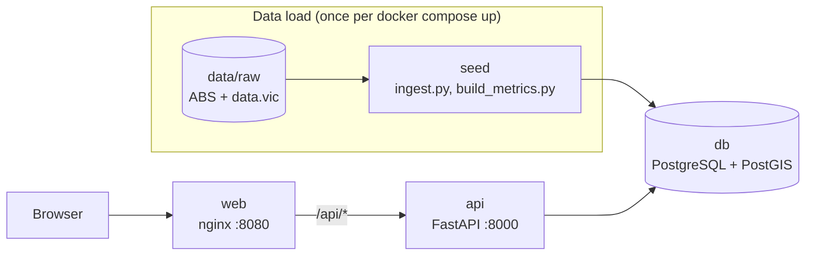

# Melbourne Heat Risk & Disadvantage Explorer

A map of urban heat, tree canopy and socio-economic disadvantage for every SA2 region in Greater
Melbourne. It asks one question: **which Melbourne suburbs carry the double burden of heat and
disadvantage?** Each region gets a transparent risk score built from public data, and regions that
are both among the hottest and among the most disadvantaged are flagged as "double burden". It is
aimed at researchers and planners who want to see where heat risk and disadvantage overlap, and
check how that result was reached. I built it to learn the kind of tooling behind
[AURIN's](https://aurin.org.au) urban climate risk work: loading open spatial data (from the
[ABS](https://www.abs.gov.au) and [data.vic.gov.au](https://www.data.vic.gov.au)) into PostGIS,
doing the spatial analysis in the database, and serving the results through an API to a web map.

Stack: Python (FastAPI, geopandas), PostgreSQL with PostGIS, React with TypeScript and Leaflet,
Docker Compose and GitHub Actions.

## Findings

- **18 SA2s carry the double burden:** they are in Melbourne's hottest fifth and in the bottom two
  national deciles for disadvantage. Turn on "Highlight double-burden areas" on the map to see them.
- **The highest risk scores are in Melbourne's north and west:** the top five are St Albans -
  South, Kings Park (Vic.), Campbellfield - Coolaroo, St Albans - North and Meadow Heights.
- **Heat differences between suburbs are small in the middle and large at the edges:** the heat
  quintile breaks are 6.8, 8.1, 8.7 and 9.6 °C, so the middle classes are only about 0.6 °C wide.
- **Tree canopy is low almost everywhere:** a fifth of SA2s have under 5.7% canopy, and only the
  top fifth have more than 18.9%.
- **Risk scores bunch together:** most residential SA2s score between about 0.46 and 0.69 (on a 0–1
  scale), which is why the map colours by quintile rather than equal intervals.

Of the 361 SA2s in Greater Melbourne, 358 have heat and canopy values and 353 have a risk score
(see [Method](#method) for the 8 left out).

## Quick start

You need [Docker](https://docs.docker.com/get-started/get-docker/) with Docker Compose.

1. Download the three source datasets into `data/raw/` as described in
   [`docs/sources.md`](docs/sources.md). They are not in git.
2. Copy the example settings: `cp .env.example .env`
3. From the repo root, run:

   ```bash
   docker compose up --build
   ```

The first run builds the images and loads the data, which takes a few minutes. Then open:

- **Map:** http://localhost:8080
- **API docs:** http://localhost:8000/docs

If a source file is missing, the `seed` service lists the missing files and stops before touching
the database. To start again from an empty database, run `docker compose down -v` first.

## Architecture



Four Docker Compose services:

- **db:** PostgreSQL 17 with PostGIS. On an empty volume it creates the tables from
  `db/init/20_schema.sql`.
- **seed:** a one-off job that loads the raw files into PostGIS (`ingest.py`) and then calculates
  every region's metrics in SQL (`build_metrics.py`), then exits. It reads `data/raw` read-only and
  replaces the data on each run.
- **api:** a FastAPI app (`backend/api.py`) that serves regions as GeoJSON, region details,
  hotspots, a CSV download and dataset sources. It starts only after `seed` finishes successfully.
- **web:** the React map, built with Vite and served by nginx. nginx also forwards `/api/*` to the
  API, so the browser only talks to one address.

## Data sources and licences

| Dataset | Publisher | Used for | Licence |
|---|---|---|---|
| [ASGS 2021 Statistical Areas Level 2](https://www.abs.gov.au/statistics/standards/australian-statistical-geography-standard-asgs/edition-3-july-2021-june-2026/access-and-downloads/digital-boundary-files) | Australian Bureau of Statistics | SA2 boundaries for Greater Melbourne | CC BY 4.0 |
| [SEIFA 2021 by SA2 (IRSD)](https://www.abs.gov.au/statistics/people/people-and-communities/socio-economic-indexes-areas-seifa-australia/2021) | Australian Bureau of Statistics | Disadvantage scores and deciles | CC BY 4.0 |
| [Metropolitan Melbourne Urban Heat Islands and Urban Vegetation 2018](https://discover.data.vic.gov.au/dataset/metropolitan-melbourne-urban-heat-islands-and-urban-vegetation-2018) | Department of Transport and Planning (Victoria) | Urban heat and tree canopy per mesh block | CC BY 4.0 |

All three are used under [CC BY 4.0](https://creativecommons.org/licenses/by/4.0/). The same list
is served by the API at `/datasets` and shown in each region's details on the map.
[`docs/sources.md`](docs/sources.md) explains which files to download and where to put them.

## Method

The whole calculation is in [`backend/sql/build_region_metrics.sql`](backend/sql/build_region_metrics.sql).
In plain language:

1. **Heat and canopy per SA2.** The heat dataset gives each 2016 mesh block an urban heat value (°C
   warmer than a non-urban baseline) and a tree canopy percentage. Mesh blocks are matched to 2021
   SA2s by shape, and each SA2's value is the average of the overlapping mesh blocks **weighted by
   overlap area**. The average is taken over the area that has data, so land without data is not
   counted as cool or treeless. Three SA2s that are less than 1% covered (border slivers such as
   Romsey and Riddells Creek) are dropped, leaving 358.
2. **Disadvantage.** Each SA2's IRSD score (Index of Relative Socio-economic Disadvantage) is
   joined in from SEIFA 2021. Five SA2s have no IRSD because nobody lives there (such as airports
   and industrial land). They keep their heat and canopy values but get no risk score.
3. **Scaling to 0–1.** Heat, canopy and IRSD are each rescaled so the lowest value among the 353
   residential SA2s is 0 and the highest is 1 (min-max scaling). Canopy and IRSD are flipped so
   that **1 is always the worst**: hottest, least canopy, most disadvantaged. The non-residential
   SA2s are left out so they do not stretch the scale.
4. **Risk score.** A weighted sum of the three scaled values. The weights are in
   [`backend/settings.toml`](backend/settings.toml) and are divided by their total, so the default
   `1, 1, 1` gives each a third. The score runs from 0 (lowest risk) to 1.
5. **Double burden.** An SA2 is flagged when it is in Melbourne's **hottest fifth** (heat quintile
   5) **and** in the **bottom two national IRSD deciles**. Regions without IRSD are left unflagged
   rather than marked "no".

The risk score and the double-burden flag measure different things. The score ranks each region
against the rest of Melbourne, while the flag uses national disadvantage deciles, so a region can
have a high score without being flagged. The flag is a simple rule that is easy to check; the score
shows the overall picture.

## API

Interactive docs are at http://localhost:8000/docs when the stack is running.

| Route | Returns |
|---|---|
| `GET /health` | Whether the API can reach the database |
| `GET /regions` | Every SA2 as GeoJSON, with the values the map colours by |
| `GET /regions.csv` | Every SA2's metrics as a CSV download |
| `GET /regions/at?lat=&lon=` | The SA2 containing a point (404 outside Greater Melbourne) |
| `GET /regions/{sa2_code}` | One SA2's metrics, rank and flags |
| `GET /hotspots?top=10` | The highest risk scores, in rank order |
| `GET /datasets` | The source datasets with publisher, licence and link |

## Development

To work on the code without Docker for the API and map, start only the database with
`docker compose up db`, then load the data and run the API from `backend/`:

```bash
uv sync
uv run --env-file ../.env python ingest.py
uv run --env-file ../.env python build_metrics.py
uv run --env-file ../.env fastapi dev api.py
```

And the map from `web/` (it forwards `/api/*` to the API on port 8000):

```bash
npm install
npm run dev
```

Then open http://localhost:5173.

**Tests and lint** (from `backend/`). The tests build a throwaway database from the schema and a
small made-up map, so they don't need the source data:

```bash
uv run --env-file ../.env pytest
uv run ruff check .
```

**CI** runs ruff, the tests (against a PostGIS service container) and `docker compose build` on
every pull request. Progress is tracked on the
[project board](https://github.com/users/rheyuh/projects/3).

## Limitations

- **Different years:** heat and canopy are from 2018 on 2016 mesh blocks, while boundaries and
  disadvantage are from 2021. Matching by area assumes heat is spread evenly within each mesh
  block.
- **Relative, not absolute:** min-max scaling and quintiles show how a region ranks within
  Melbourne, not how large the differences are, and one extreme region can compress everyone else's
  scores.
- **Equal weights are a choice:** heat, canopy and disadvantage count equally by default. Changing
  the weights in `settings.toml` changes the ranking.
- **Data is downloaded by hand:** the source files are not in git and are not fetched
  automatically, and `seed` reloads every table on each `docker compose up`.
- **Desktop layout:** the map's cards cover most of the screen on a phone.
- **No frontend tests:** the map was checked by hand; the backend has automated tests.
